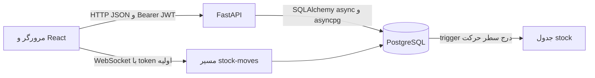

# نمای کلی سیستم

**تأییدشده:** Tabulae برنامهٔ مدیریت موجودی برای کاربران، کالاها، دسته‌ها، انبارها، ورود و خروج کالا، موجودی به تفکیک lot، تاریخ انقضا و گزارش است. شواهد: routeهای `frontend/src/router/AppRouter.jsx:43`، routerهای `backend/app/main.py:47` و مدل‌های `backend/app/models/`. مسئلهٔ تجاری آن ثبت منشأ تغییر موجودی و نمایش جمع موجودی و تاریخچه است؛ این هدف از `StockMove` و `StockMoveLine` و trigger `update_stock()` استنباط می‌شود (`backend/app/models/stock_move.py:6`، `db_init/01_db_tables_trigger.sql:73`).

## فناوری و مرزها

**تأییدشده:** frontend از React 19، React Router 7، Vite 6، Tailwind 4، Recharts 2 و `fetch` بومی استفاده می‌کند (`frontend/package.json:16`، `frontend/src/i18n/errors.js:118`). backend روی Python 3.12 در Docker، FastAPI 0.121.1، Pydantic 2.12.4، SQLModel 0.0.27، SQLAlchemy 2.0.44 و asyncpg 0.31.0 است (`backend/Dockerfile:2`، `backend/requirements.txt`). Compose تصویر PostgreSQL 17 را تعیین می‌کند (`docker-compose.yml:15`). اینها نسخه‌های پیکربندی شده‌اند؛ نسخهٔ runtime زنده بررسی نشده است.

نقطهٔ ورود مرورگر `frontend/index.html` ← `frontend/src/main.jsx:22` ← `App.jsx` ← `AppRouter.jsx` است. backend با `app.main:app` بالا می‌آید (`backend/Dockerfile:24`)؛ `lifespan` در `backend/app/main.py:19` در آغاز `create_db_and_tables()` را صدا می‌زند. این تابع `SQLModel.metadata.create_all` را اجرا می‌کند (`backend/app/models/database.py:25`). routerها و CORS در `backend/app/main.py:33-56` ثبت می‌شوند. **تأییدشده:** startup هیچ trigger را از SQL script اجرا نمی‌کند؛ scriptهای `db_init` فقط در مقداردهی اولیهٔ volume رسمی PostgreSQL اجرا می‌شوند (`docker-compose.yml:23`).

الگوهای مشاهده شده عبارت‌اند از SPA مبتنی بر component، Context برای auth، API service functions، router و dependencyهای FastAPI، schemaهای Pydantic جدا از مدل‌های SQLModel، و سرویس مجزای ایجاد حرکت (`frontend/src/context/AuthProvider.jsx:11`، `backend/app/services/stock_move_service.py:76`). معماری لایه‌ای کامل برای همهٔ عملیات وجود ندارد: بسیاری از قواعد محصول و انبار مستقیماً در routerها هستند (`backend/app/routers/products.py:132`، `backend/app/routers/warehouses.py:170`).

تنظیم‌های مهم: `.env.template` فقط نام متغیرها را معرفی می‌کند؛ `.env` خوانده شد اما مقدارهای آن در این اسناد افشا نمی‌شوند. `backend/app/utils/getenv.py:4` در غیر production، `.env` را بارگذاری می‌کند؛ `frontend/src/api/config.js:1` وجود `VITE_API_URL` را الزام می‌کند. فایل‌های Compose، Dockerfile، `frontend/nginx.conf` و `frontend/vite.config.js` مسیر استقرار را تعیین می‌کنند. برای جزئیات به [زیرساخت](11-infrastructure-devops.md) بروید.
