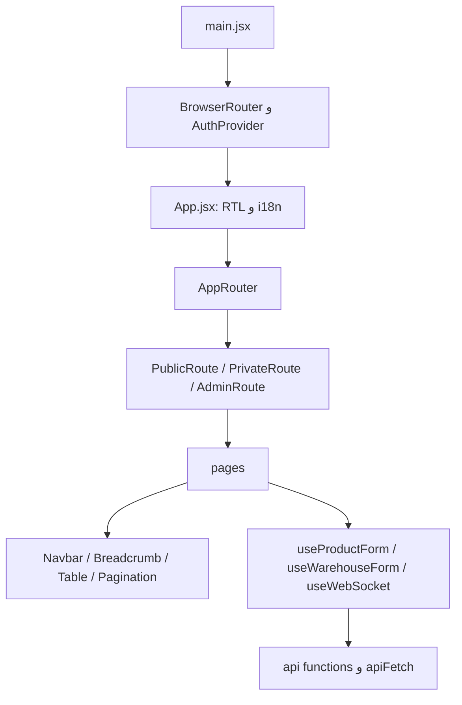
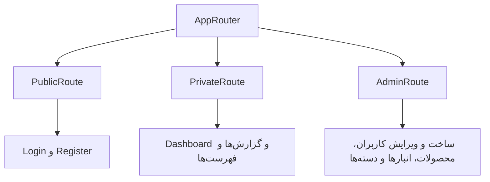
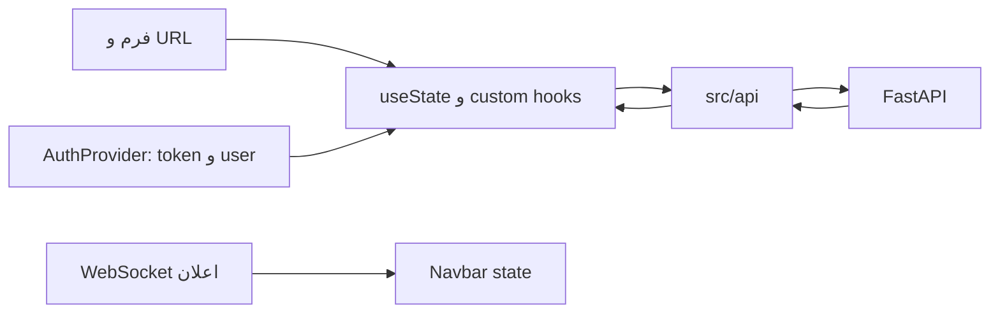
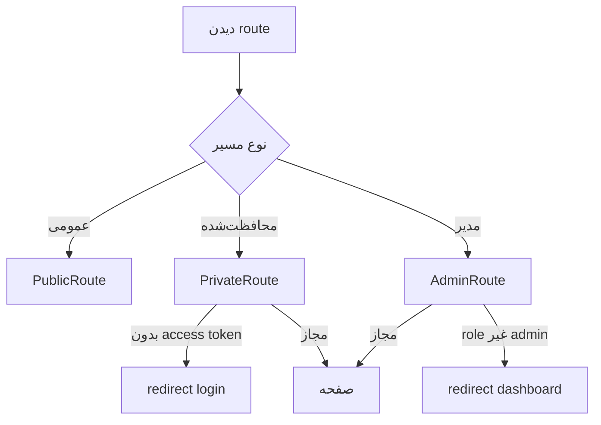
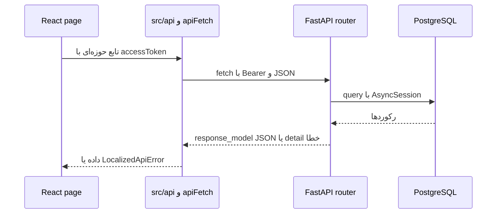

# معماری frontend

## فناوری و راه‌اندازی

React 19 componentها و hookها را اجرا می‌کند، `BrowserRouter` مسیر مرورگر را در اختیار `AppRouter` می‌گذارد و `AuthProvider` وضعیت ورود را به فرزندان می‌رساند (`frontend/package.json:23-26`، `frontend/src/main.jsx:22-29`). Vite 6 bundler است و pluginهای React و Tailwind CSS 4 را ثبت می‌کند (`frontend/vite.config.js`). `frontend/src/index.css` قلم Vazirmatn، Tailwind و نمایش LTR مقدارهای فنی را تعیین می‌کند؛ `frontend/src/App.jsx:13` مقدارهای `lang=fa` و `dir=rtl` را در ظرف اصلی می‌گذارد. `@headlessui/react` برای `Menu` در `Navbar.jsx:5`، `react-select/async` در `LocalizedAsyncSelect.jsx:1`، و Recharts برای نمودارهای Dashboard و صفحه‌های گزارش استفاده می‌شوند. `fetch` بومی کلاینت HTTP است؛ Axios در `frontend/package.json` وجود ندارد. `@material-tailwind/react` dependency اعلام شده، ولی استفادهٔ مؤثر آن در `src` در این بررسی تأیید نشد. تصمیم تاریخی انتخاب کتابخانه‌ها **نامعلوم** است؛ سود عملی آنها در کد، menu قابل استفاده، select async و نمودار است. محدودیت کنونی: تعداد زیادی request تابع مشترک retry/cancellation ندارند و برخی صفحه‌ها از `alert` استفاده می‌کنند (`frontend/src/pages/CreateMovement.jsx:187-194`).

## مسیرها

منبع جدول `frontend/src/router/AppRouter.jsx:43-95` است. «کاربر» یعنی `PrivateRoute`؛ «مدیر» یعنی `AdminRoute`. وابستگی API با import صفحه/تابع‌های آن بررسی شده و در صفحه‌های dashboard چند API به صورت خلاصه آمده است.

| URL | صفحه | دسترسی | API اصلی / هدف |
|---|---|---|---|
| `/` | redirect | عمومی | `/login` |
| `/login` | Login | عمومی؛ واردشده redirect | `auth.login` |
| `/register` | Register | عمومی؛ واردشده redirect | `auth.register` |
| `/dashboard` | Dashboard | کاربر | `stock` و `products`؛ نمای آماری |
| `/products` | Products | کاربر | `stock`؛ نمودار دسته |
| `/products/list` | ProductList | کاربر | `products.getProducts`؛ فهرست |
| `/products/:id` | ProductDetail | کاربر | `products.getProductById`؛ جزئیات |
| `/products/:id/stock` | ProductStock | کاربر | `stock.getStockByProduct` |
| `/products/:id/history` | ProductHistory | کاربر | `stock.getProductHistory` |
| `/products/new` | NewProduct | مدیر | `products.createProduct` و دسته‌ها |
| `/products/:id/edit` | EditProduct | مدیر | `getProductById`، `updateProduct`، `deleteProduct` |
| `/categories` | Categories | مدیر | CRUD دسته در `api/products.js` |
| `/warehouses` | Warehouses | کاربر | `stock`؛ نمودار انبار |
| `/warehouses/list` | WarehouseList | کاربر | `getAllWarehouses`؛ فهرست |
| `/warehouses/:id` | WarehouseDetail | کاربر | `getWarehouseById` |
| `/warehouses/new` | NewWarehouse | مدیر | `createWarehouse` |
| `/warehouses/:id/edit` | EditWarehouse | مدیر | `getWarehouseById`، `warehouseUpdate` |
| `/stock/warehouse/:warehouse_id` | WarehouseStock | کاربر | `getStockByWarehouse` |
| `/stock/warehouse/:warehouse_id/history` | WarehouseStockHistory | کاربر | `getWarehouseHistory` |
| `/stock/warehouse/:warehouse_id/product/:product_id` | ProductStockByWarehouse | کاربر | `getProductStockByWarehouse` |
| `/stock/warehouse/:warehouse_id/products/:product_id/history` | ProductHistoryByWarehouse | کاربر | `getProductHistoryByWarehouse` |
| `/stock-movements` | StockMovements | کاربر | `stock_moves`؛ نمودار |
| `/stock-movements/list` | MovementList | کاربر | `getStockMovements` |
| `/stock-movements/:id` | MovementDetail | کاربر | `getStockMovementById` و lines |
| `/stock-movements/new` | CreateMovement | کاربر | `createMovement`، جست‌وجوی محصول/انبار/lot |
| `/expiration` | ExpirationStock | کاربر | `getExpirationProducts` |
| `/profile` | Profile | کاربر | `auth` و `users` |
| `/users` | Users | مدیر | `getUsers` |
| `/users/new` | NewUser | مدیر | `createUser` |
| `/users/:id/edit` | EditUser | مدیر | `getUserById`، `updateUser`، `deleteUser` |

`PrivateRoute.jsx:5-20` هنگام بارگذاری پیام نشان می‌دهد و بدون token به login می‌فرستد. `AdminRoute.jsx:5-15` نقش context را برای UI می‌سنجد؛ کنترل واقعی در backend است. `PublicRoute.jsx:4-8` کاربر واردشده را به dashboard می‌برد. route با `*` یا صفحهٔ 404 در `AppRouter.jsx` تعریف نشده است. `Navbar.jsx` لینک‌ها و menuها را فراهم می‌کند؛ `Breadcrumb.jsx` مسیر بازگشت را می‌سازد. پارامترهای `:id`، `:warehouse_id` و `:product_id` با hookهای Router خوانده می‌شوند؛ `ExpirationStock.jsx:4-52` filter را در query string نگه می‌دارد.

## وضعیت و ارتباط API

وضعیت محلی با `useState` برای فرم و loading/error استفاده می‌شود (`frontend/src/pages/Login.jsx:8-20`). Context فقط auth مشترک را نگه می‌دارد: access token در حافظه، user، loading و توابع login/logout (`frontend/src/context/AuthProvider.jsx:11-17,164-179`). cookie HttpOnly refresh در JavaScript خوانده نمی‌شود؛ `refreshAccessToken` درخواست `credentials: include` می‌فرستد (`:48-76`). `frontend/src/hooks/useProductForm.js` و `frontend/src/hooks/useWarehouseForm.js` فرم، بارگذاری، خطا و ذخیره را در hook جمع کرده‌اند؛ `useWarehouseRequest.js:5-21` پاسخ‌های قدیمی پس از تغییر loader را نادیده می‌گیرد. `useWebSocket.js:5-35` اعلان متن را به callback `Navbar.jsx:38` می‌رساند؛ خود اعلان، دادهٔ جدول‌ها را خودکار بازخوانی نمی‌کند مگر مصرف‌کننده چنین کاری کند.

نمونهٔ واقعی: `NewProduct.jsx:25-29` ← `useProductForm.save:61-83` ← `submitProductForm` در `utils/productForm.js` ← `createProduct` در `api/products.js:51-62` ← `apiFetch` در `i18n/errors.js:118-136` ← `POST /products` با `Content-Type: application/json` و `Authorization: Bearer ...` ← JSON `ProductResponse`. `apiFetch` خطا را محلی‌سازی می‌کند ولی retry و AbortController عمومی ندارد؛ API response موفق را تابع service با `.json()` می‌خواند. `frontend/src/api/config.js:1-6` آدرس پایه را از `VITE_API_URL` می‌گیرد. `getProducts` و `getAllWarehouses` فیلتر و صفحه‌بندی را به query string می‌برند (`frontend/src/api/products.js:4-26`، `frontend/src/api/warehouses.js:4-23`). برای افزودن صفحه: مسیر را در `AppRouter` و guard مناسب ثبت کنید، تابع API را در حوزهٔ `src/api` قرار دهید، متن‌ها را در `src/i18n/fa.js` اضافه کنید، وضعیت loading/error/empty و RTL را بررسی کنید و آزمون localization مرتبط را اجرا کنید.

## اجزای UI

`Navbar` و `Breadcrumb` در بیشتر صفحه‌ها تکرار می‌شوند. جدول‌های حوزه‌ای در `components/*Table.jsx`، جست‌وجو در `SearchInput`، فیلتر در `SelectFilter`/`ContainerFilters`، صفحه‌بندی در `Pagination` و CSV در `ExportCSVButton` و `utils/export.js` است. نمودارها در صفحه‌های Dashboard/Products/Warehouses/StockMovements با Recharts ساخته می‌شوند. `LocalizedAsyncSelect` پیام‌های `react-select` را بومی می‌کند. متن‌ها در `i18n/fa.js`، تابع `t` در `i18n/index.js` و ترجمهٔ خطا/validation در `i18n/errors.js` است. `App.jsx:13` رویدادهای اعتبارسنجی بومی مرورگر را نیز محلی می‌کند. طراحی responsive با کلاس‌های Tailwind مثل `sm:` و `lg:` در صفحه‌ها دیده می‌شود؛ کیفیت واقعی روی دستگاه‌ها **نامعلوم** است.

`Navbar.jsx:5-12` از `Disclosure` و `Menu` کتابخانهٔ Headless UI برای ناوبری استفاده می‌کند. اعلان حرکت دریافتی از WebSocket در state و `localStorage` تا پنج مورد نگه داشته می‌شود (`Navbar.jsx:20-45`) و با `i18n/notifications.js` برای نمایش ترجمه می‌شود. تأیید حذف/غیرفعال‌سازی در مسیرهای بررسی‌شده با `window.confirm` و موفقیت با `alert` یا پیام درون صفحه است (`frontend/src/pages/EditWarehouse.jsx:26-30`، `NewProduct.jsx:25-29`، `WarehouseList.jsx:55-67`)؛ component modal سفارشی در این مسیرها مشاهده نشد. `useWarehouseRequest` loading، missing، error و retry را مدل می‌کند (`frontend/src/hooks/useWarehouseRequest.js:5-21`) و `WarehouseRequestFeedback` آن را نشان می‌دهد. `apiFetch` retry خودکار یا cancellation ندارد؛ بعضی hookها با flag پاسخ دیرهنگام را نادیده می‌گیرند (`useWarehouseForm.js:25-45`).

