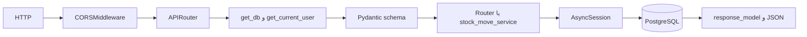
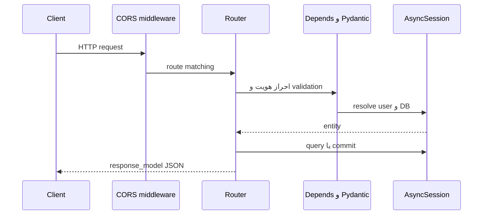
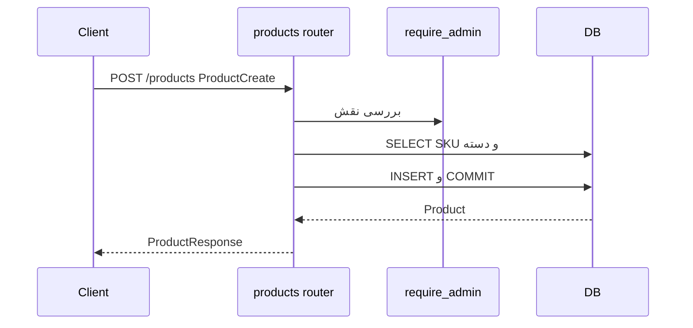
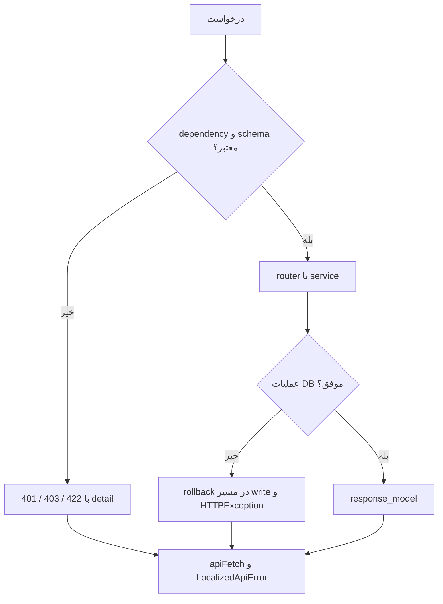

# معماری backend

## راه‌اندازی و چرخهٔ درخواست

`backend/Dockerfile:24` در production از Gunicorn با چهار `UvicornWorker` و `backend/Dockerfile.dev:18` از Uvicorn با reload استفاده می‌کند. import شدن `app.main:app`، `DATABASE_URL` و `SECRET_KEY` را از `backend/app/models/database.py:9` و `backend/app/utils/authentication.py:15` می‌خواهد. سپس `FastAPI(..., lifespan=lifespan)` ساخته می‌شود، CORS و هشت router ثبت می‌شوند (`backend/app/main.py:25-56`). در آغاز lifespan، `SQLModel.metadata.create_all` اجرا می‌شود (`backend/app/main.py:20`، `backend/app/models/database.py:27`). کد shutdown صریح جز پایان context دیده نشد؛ بستن engine در lifespan انجام نمی‌شود.

`get_db` برای هر درخواست `AsyncSession` می‌سازد و با پایان dependency آن را می‌بندد (`backend/app/models/database.py:19-22`). `get_current_user` توکن Bearer را با `decode_access_token` می‌خواند، `jti` را در `RevokedToken` و `sub` را در `User` بررسی می‌کند و کاربر غیرفعال را رد می‌کند (`backend/app/dependencies.py:14-62`). `require_admin` نقش را از **رکورد تازهٔ کاربر** بررسی می‌کند (`backend/app/dependencies.py:65`). `Depends` وابستگی‌ها را پیش از بدنهٔ endpoint حل می‌کند؛ نمونهٔ روشن `create_product` است (`backend/app/routers/products.py:131-136`). `OAuth2PasswordRequestForm` در login فرم URL encoded را می‌پذیرد (`backend/app/routers/auth.py:63-73`).

## لایه‌ها و قواعد

`routers/` HTTP، کنترل دسترسی، query و بسیاری از قواعد را پیاده می‌کند. `schemas/` قرارداد داده است؛ برای نمونه `ProductCreate` قاعدهٔ SKU و `ProductResponse` نام دسته را تعریف می‌کند (`backend/app/schemas/product.py:6-57`). `models/` نگاشت جدول است؛ `Product` کلید خارجی `category_id` دارد (`backend/app/models/product.py:4-12`). `services/stock_move_service.py:76-143` تنها سرویس تجاری جداشدهٔ اصلی است: اعتبارسنجی، `flush` سربرگ، درج سطرها، `commit` و `rollback`. روی `stock_move_line`، trigger PostgreSQL موجودی را تغییر می‌دهد (`db_init/01_db_tables_trigger.sql:135`). endpoint `WebSocket` نخست token متنی را از client می‌گیرد و سپس اتصال را برای اعلان‌های server باز نگه می‌دارد (`backend/app/routers/websocket.py:45-76`)؛ `create_movement` پس از commit، broadcast می‌کند (`backend/app/routers/stock_moves.py:240-267`). کار پس‌زمینهٔ FastAPI `BackgroundTasks` در کد دیده نشد.

`ProductCreate` درخواست JSON را با Pydantic اعتبارسنجی می‌کند؛ `Product` شیء ORM/SQLModel نگاشته‌شده به ردیف `product` است؛ `ProductResponse` خروجی HTTP را همراه `category_name` حاصل از join تعریف می‌کند (`backend/app/schemas/product.py:6-57`، `backend/app/models/product.py:4-12`، `backend/app/routers/products.py:131-188`). رکورد PostgreSQL خود شیء Python نیست؛ ORM آن را به شیء تبدیل می‌کند. یکتایی SKU هم در مدل/DB است و هم پیش از INSERT در router بررسی می‌شود؛ قاعدهٔ «دسته وجود دارد» در router است (`products.py:139-161`). خطای schema معمولاً پیش از بدنهٔ تابع به 422 می‌رسد؛ خطای business ممکن است 400/403/404 باشد.

برای CRUD محصول: POST با `ProductCreate` اعتبارسنجی می‌شود، `require_admin` اجرا می‌شود، SKU و دسته در router بررسی می‌شوند، `db.add` و `commit` انجام می‌شود و `ProductResponse` برمی‌گردد (`backend/app/routers/products.py:131-188`). GET محصول join با دسته دارد (`:91-129`)، PUT با `model_dump(exclude_unset=True)` و `sqlmodel_update` فیلدهای ارسال‌شده را به‌روزرسانی می‌کند (`:233-332`)، DELETE رکورد را حذف و در خطای FK پاسخ 409 می‌دهد (`:335-366`). انبار نیز router مستقیم دارد (`backend/app/routers/warehouses.py:141-271`). فقط GET، POST، PUT و DELETE در routerهای HTTP دیده شدند؛ PATCH تعریف نشده است. معنای واقعی DELETE انبار در `deactivate_warehouse` حذف فیزیکی **پس از** غیرفعال بودن، خالی بودن و نداشتن حرکت است؛ نام تابع به تنهایی گمراه‌کننده است.

خطاهای `HTTPException` به JSON با `detail` می‌روند؛ خطاهای schema معمولاً 422 با فهرست `detail` هستند. بسیاری از routerها `SQLAlchemyError` را به 500 عمومی تبدیل می‌کنند؛ مسیرهای نوشتن غالباً `rollback` دارند (`backend/app/routers/products.py:171-186`، `backend/app/services/stock_move_service.py:127-141`). handler سفارشی سراسری در `backend/app/main.py` دیده نشد. سمت frontend، `apiFetch` بدنهٔ خطا را خوانده و `LocalizedApiError` می‌سازد (`frontend/src/i18n/errors.js:118-136`).

