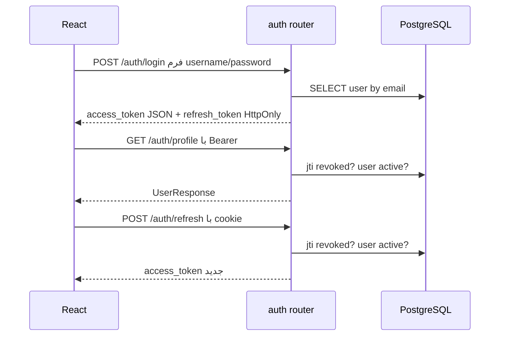

# احراز هویت، مجوز و مرزهای امنیتی

## چرخهٔ JWT

`register` کاربر را با نقش ثابت `user` و `is_active=False` ثبت و رمز را با bcrypt hash می‌کند (`backend/app/routers/auth.py:28-59`، `backend/app/utils/authentication.py:24-31`). `login` فیلد `username` از `OAuth2PasswordRequestForm` را به email نگاشت می‌کند، رمز و فعال بودن را می‌سنجد، access و refresh token می‌سازد (`backend/app/routers/auth.py:63-99`). تابع‌های تولید token، `sub`، `exp`، `jti` و `type` را در JWT با HS256 امضا می‌کنند؛ access علاوه بر این `role` دارد (`backend/app/utils/authentication.py:15-47`). زمان پیش‌فرض access **۳۰ دقیقه** و refresh **۷ روز** است (`:20-22`). اینها مقدارهای پیش‌فرض کدند؛ تنظیم runtime می‌تواند فرق کند.

access token در پاسخ JSON است و `AuthProvider` آن را در state حافظه نگه می‌دارد (`frontend/src/context/AuthProvider.jsx:12,80-95`). refresh token در cookie `HttpOnly` با `path=/auth/`، در production با `Secure=true` و `SameSite=None` و در development با `Secure=false` و `SameSite=Lax` تنظیم می‌شود (`backend/app/routers/auth.py:101-124`). `AuthProvider.refreshAccessToken` هنگام بارگذاری و نزدیک انقضا، `POST /auth/refresh` را با cookie می‌فرستد و سپس `/auth/profile` را برای کاربر می‌خواند (`frontend/src/context/AuthProvider.jsx:37-76,121-123`). `get_current_user` access token را با انتظار `type=access` decode می‌کند، jti لغوشده و user فعال را از DB می‌سنجد (`backend/app/dependencies.py:14-62`). `refresh_token` همین کار را برای `type=refresh` و cookie انجام می‌دهد (`backend/app/routers/auth.py:139-199`). `logout` cookie را حذف و jtiهای access و refresh را در `revoked_tokens` ثبت می‌کند (`:215-270`). پاک‌سازی دوره‌ای این جدول در کد دیده نشد.

`require_admin` نقش رکورد فعلی User را بررسی می‌کند، نه claim نقش JWT (`backend/app/dependencies.py:65-72`). UI نیز `AdminRoute` دارد (`frontend/src/router/AdminRoute.jsx:5-15`) ولی این فقط نمایش است؛ endpointهای مدیر با `Depends(require_admin)` محافظت شده‌اند. `users.get_user`/`update_user` اجازهٔ خود کاربر یا مدیر را پیاده می‌کنند (`backend/app/routers/users.py:116-148,191-290`). `stock_moves.get_movements` حرکت‌های کاربر عادی را به `user_id` خودش محدود می‌کند (`backend/app/routers/stock_moves.py:70-74`). **تأییدشده:** `stock.get_stock_history` همهٔ خطوط حرکت را به هر کاربر احرازشده بازمی‌گرداند (`backend/app/routers/stock.py:425-468`). اینکه این دید عمومی عمدی است **نامعلوم**.

## ارزیابی دفاعی

| یافته و شاهد | اثر بالقوه | اطمینان | اقدام پیشنهادی |
|---|---|---|---|
| refresh از cookie cross-site استفاده می‌کند ولی در `auth.refresh_token:139` کنترل CSRF token/Origin دیده نمی‌شود؛ CORS دارای allowlist است (`main.py:33-44`) | فراخوانی refresh از مبدأ دیگر، بسته به تنظیم مرورگر/استقرار؛ پاسخ فقط در مبدأ مجاز خواندنی است | متوسط، وابسته به استقرار | سیاست SameSite متناسب با topology و بررسی Origin/CSRF برای عملیات cookie-based |
| `websocket_endpoint` از `decode_access_token(token)` بدون `expected_type` استفاده می‌کند و jti را بررسی نمی‌کند (`routers/websocket.py:45-70`) | refresh یا token لغوشده، تا انقضا می‌تواند اتصال تازه بگیرد؛ اتصال موجود پس از تغییر حساب هم ادامه می‌یابد | بالا از کد | `type=access`، revocation و Origin را پیش از authorize بررسی کنید |
| `ConnectionManager` فقط در حافظهٔ هر worker است (`routers/websocket.py:11-41`) و production چهار worker دارد (`backend/Dockerfile:24`) | اعلان به clientهای workerهای دیگر نمی‌رسد | بالا | pub/sub مشترک مانند Redis یا broker |
| `update_stock()` قبل از `UPDATE` تعداد را با SELECT می‌سنجد و سپس `GREATEST(0, ...)` می‌زند (`db_init/01_db_tables_trigger.sql:112-128`) | خروج هم‌زمان ممکن است بیش از موجودی ثبت شود و کمبود با صفر پنهان شود | متوسط؛ نیازمند آزمون هم‌زمانی | UPDATE شرطی اتمیک با بررسی تعداد سطر، یا قفل ردیف |
| `WarehouseUpdate` نام خالی را در schema منع نمی‌کند (`backend/app/schemas/warehouse.py:22-36`)؛ مدل/SQL هم فقط NOT NULL دارند | نام whitespace/خالی ممکن است ذخیره شود | بالا | validation حداقل طول پس از trim در schema و DB |
| `auth.refresh_token:165-170` و `dependencies.get_current_user:38`، `sub` را با `int` تبدیل می‌کنند؛ WebSocket نیز چنین می‌کند (`websocket.py:65`) | claim امضاشده با sub نامعتبر ممکن است به خطای 500/قطع غیرمدیریت‌شده برسد | متوسط | تبدیل امن و پاسخ 401/کد WebSocket 1008 |
| محدودسازی نرخ در routerها/`main.py` دیده نشد؛ login رمز را با bcrypt می‌سنجد (`auth.py:63-91`) | تلاش تکراری login و فشار محاسباتی | بالا از نبود کنترل در همین سرویس؛ کنترل بیرونی نامعلوم | rate limit در gateway یا backend، ثبت رخداد |
| `UserAdminCreate.role` از نوع Optional است ولی `create_user` بدون بررسی `.lower()` می‌زند (`backend/app/schemas/user.py:25-41`، `backend/app/routers/users.py:87-94`) | ارسال `null` ممکن است به خطای 500 برسد | بالا از کد؛ اجرا نشده | مقدار null را در schema منع یا در handler مدیریت کنید |
| SQLModel `select`/پارامترسازی در routerها به کار می‌رود (`products.py:141`، `stock.py:804`) | مقاومت در برابر SQL injection در queryهای بررسی‌شده | بالا | همین روش را حفظ و query خام آینده را review کنید |

`ALLOWED_ORIGINS` از محیط می‌آید و `allow_credentials=True` است (`backend/app/main.py:33-44`)؛ مقدار runtime آن افشا یا بررسی نشده. TLS، secret rotation، backup، gateway و سیاست امنیتی استقرار **نامعلوم** هستند. پاسخ‌های `HTTPException` غالباً متن عمومی دارند، ولی خطای validation می‌تواند نام فیلد و مقدار ورودی را در `detail` داشته باشد؛ `frontend/src/i18n/errors.js:15-108` آن را به متن فارسی تبدیل می‌کند. `SECRET_KEY` از محیط لازم است؛ هیچ مقدار محرمانه‌ای در این سند ثبت نشده است.
