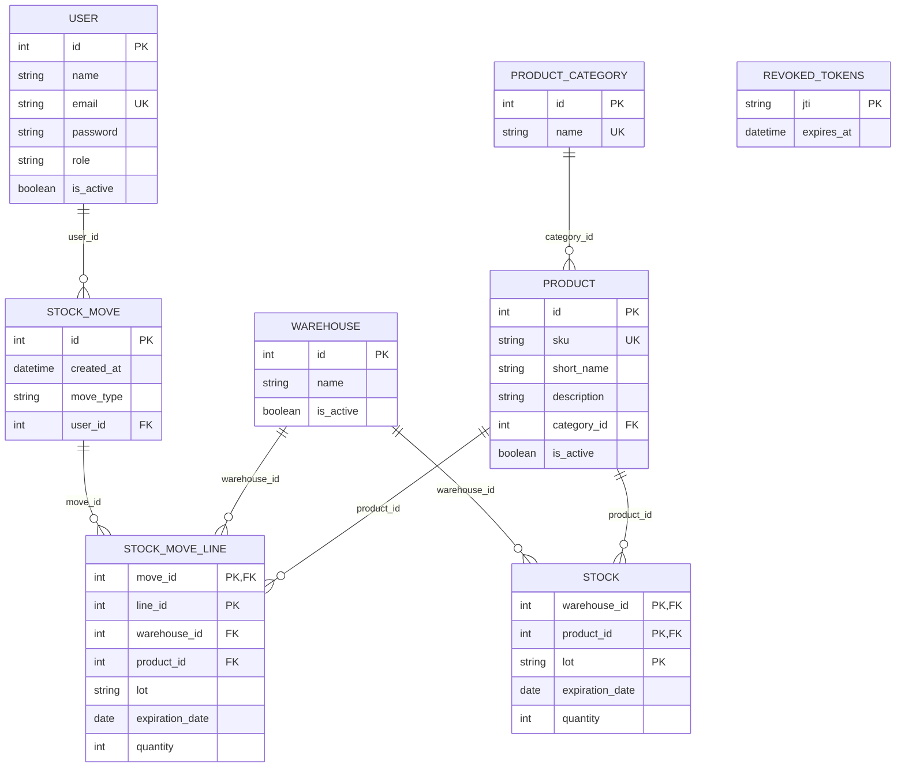
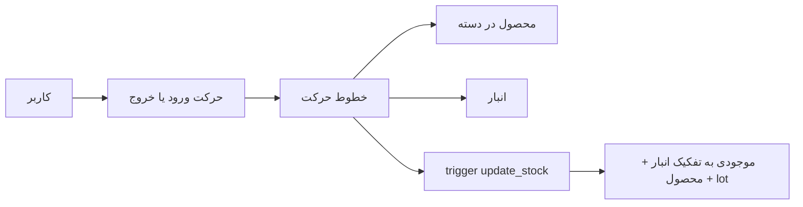

# نمودارهای ER

این نمودارها از `backend/app/models/*.py` و `db_init/01_db_tables_trigger.sql:5-70` استخراج شده‌اند؛ **schema پایگاه دادهٔ در حال اجرا بررسی نشده است**. `revoked_tokens` فقط در ORM تعریف شده و رابطهٔ FK ندارد. کاردینالیتی‌ها از FKهای صریح و قابلیت تهی نبودن گرفته شده‌اند. ترکیب `warehouse_id, product_id, lot` کلید stock و `move_id, line_id` کلید line است.

## ER کامل

## تصویر مفهومی

`REVOKED_TOKENS` به `USER` وصل نشده است: `jti` صرفاً شناسهٔ JWT است (`backend/app/models/revoked_token.py:4-8`). هیچ FK برای آن در کد تعریف نشده؛ اتصال در ER اختراع نمی‌شود. تعداد خط هر حرکت در schema می‌تواند صفر باشد، هرچند سرویس ایجاد حرکت آن را منع می‌کند (`backend/app/services/stock_move_service.py:16-28`).
