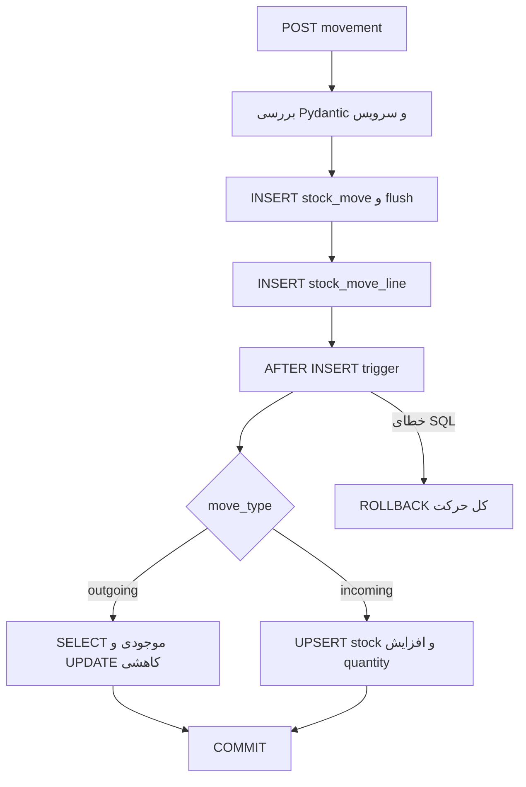

# قواعد واقعی موجودی و تراکنش‌ها

محصول باید SKU با حروف بزرگ/عدد، طول ۳ تا ۲۰ و دستهٔ موجود داشته باشد (`backend/app/schemas/product.py:6-20`، `backend/app/routers/products.py:139-169`). غیرمدیر فقط محصول فعال را در فهرست و جزئیات می‌بیند (`products.py:54-59,120-124`). غیرفعال‌سازی محصول با موجودی مثبت رد یا در bulk رد و در شمار skipped می‌رود (`products.py:191-230,278-294`). دسته هنگام ایجاد/ویرایش با `normalize_category` trim و capital می‌شود (`product_categories.py:44-96`، `utils/validation.py:5-17`) و حذف دستهٔ دارای محصول مجاز نیست (`product_categories.py:99-136`).

انبار را فقط مدیر می‌سازد/ویرایش می‌کند (`backend/app/routers/warehouses.py:141-228`). فهرست `get_warehouses` حتی انبار غیرفعال را برای کاربر عادی برمی‌گرداند (`:24-67`)، ولی جزئیات آن را برای غیرمدیر رد می‌کند (`:111-138`). **ناهمسانی تأییدشده:** ویرایش تکی اگر هر ردیف `stock` وجود داشته باشد، حتی با تعداد صفر، غیرفعال‌سازی را رد می‌کند (`:184-202`)، اما bulk فقط مجموع مثبت را مانع می‌داند (`:69-108`). DELETE واقعی تنها برای انبار غیرفعال، بدون هیچ ردیف موجودی و بدون خط حرکت انجام می‌شود (`:230-289`).

حرکت با `StockMoveCreate` شامل `move_type` برابر incoming/outgoing و خطوط با تعداد حداقل ۱ است (`backend/app/schemas/stock_move.py:7-22`، `schemas/stock_move_line.py:6-24`). سرویس پیش از DB، ۱ تا ۱۰۰ خط و تاریخ آیندهٔ ورودی را بررسی می‌کند؛ بعد فعال بودن انبارها و محصولات را می‌سنجد (`backend/app/services/stock_move_service.py:16-74`). user_id از `current_user.id` گرفته می‌شود، نه بدنهٔ client (`backend/app/routers/stock_moves.py:240-251`). سربرگ و خطوط در یک commit هستند (`backend/app/services/stock_move_service.py:95-125`). پس از commit، router WebSocket را broadcast می‌کند و خطای اعلان فقط log می‌شود (`backend/app/routers/stock_moves.py:253-267`).

تابع `update_stock()` نوع حرکت را از سربرگ می‌خواند، lot خالی را `NO_LOT` می‌کند، تاریخ انقضا برای `NO_LOT` را رد می‌کند، ورود را با `INSERT ... ON CONFLICT DO UPDATE` جمع می‌کند و خروج را بعد از بررسی موجودی با `UPDATE` کم می‌کند (`db_init/01_db_tables_trigger.sql:73-139`). trigger فقط **AFTER INSERT** روی `stock_move_line` است؛ UPDATE یا DELETE خط موجودی را بازحساب نمی‌کند. Python به نصب بودن آن وابسته است، چون خود سرویس stock را نمی‌نویسد. constraintهای اصلی: quantity خطوط >۰، stock ≥۰، FKها و PK مرکب (`db_init/01_db_tables_trigger.sql:47-70`). **ریسک استنباطی با اطمینان متوسط:** SELECT موجودی و UPDATE جداگانه در خروج هم‌زمان ممکن است هر دو موجودی کافی ببینند؛ `GREATEST(0,...)` از مقدار منفی جلوگیری می‌کند اما ثبت دو خروج را الزاماً متوقف نمی‌کند. آزمون هم‌زمانی روی DB زنده انجام نشده است.

گزارش موجودی `stock` را با `func.sum` تجمیع می‌کند (`backend/app/routers/stock.py:316-369,682-717`) و تاریخچه را از حرکت‌ها و خطوط می‌خواند (`:425-624`). `get_available_lots` فقط lotهای با quantity مثبت را بازمی‌گرداند (`:798-840`). `get_stock_status_semaphore` مقدارهای تا یک ماه، یک تا شش ماه و بدون انقضا/بعدتر را گروه‌بندی می‌کند (`:626-679`)؛ نام فیلد `expired` در عمل «منقضی یا نزدیک یک ماه» است. همهٔ اینها read query هستند؛ وضعیت اجرای واقعی و سرعت روی دادهٔ تولیدی **نامعلوم** است.
