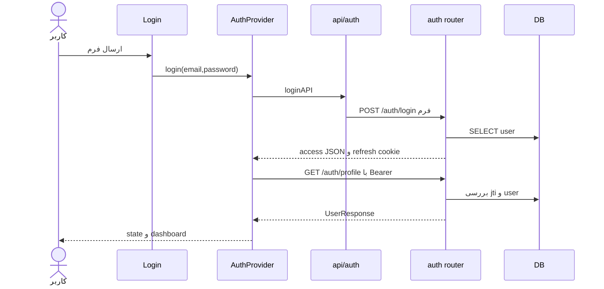
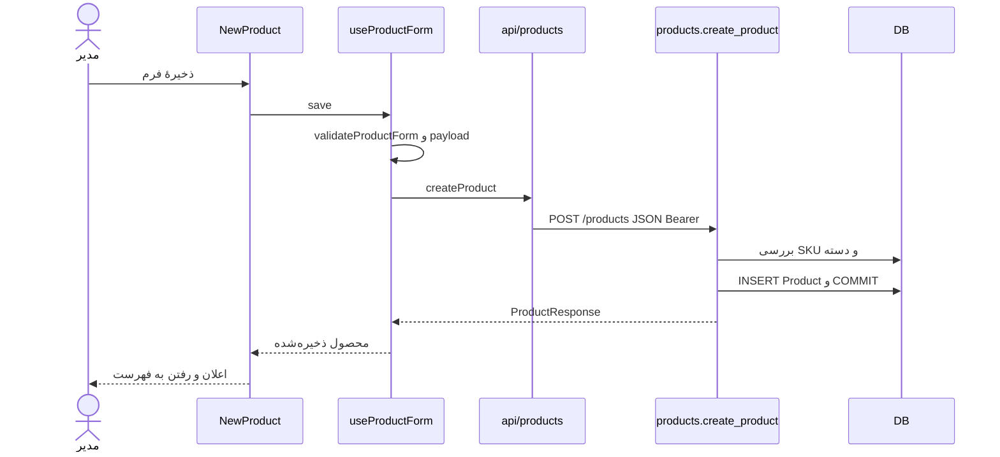
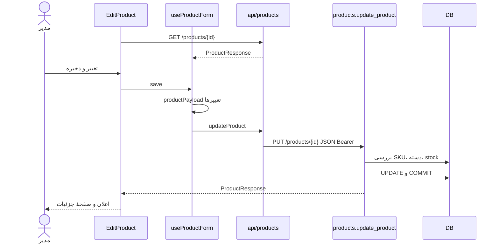
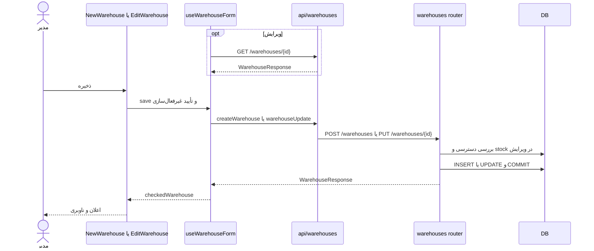
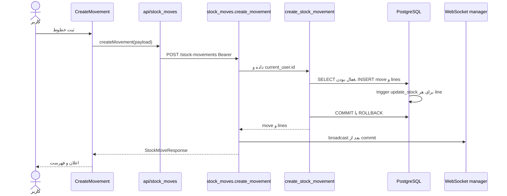

# پنج جریان سرتاسری

همهٔ جریان‌ها **از کد تأیید شده‌اند**؛ اجرای زندهٔ backend انجام نشد. در هر مورد خطاهای 422 از Pydantic و 401/403 از dependency می‌توانند پیش از بدنهٔ router برگردند (`backend/app/dependencies.py:14-72`). `apiFetch` خطای HTTP را به `LocalizedApiError` فارسی تبدیل می‌کند (`frontend/src/i18n/errors.js:118-136`).

## ۱. ورود کاربر

`Login.handleSubmit` email/password محلی را به `AuthProvider.login` می‌دهد (`frontend/src/pages/Login.jsx:7-20`). `api/auth.js:4-19` بدنهٔ `username=email&password=...` با نوع `application/x-www-form-urlencoded` و `credentials: include` می‌فرستد. `auth.login` کاربر را با email پیدا می‌کند، bcrypt و فعال بودن را می‌سنجد و `{access_token,token_type}` و cookie refresh را برمی‌گرداند (`backend/app/routers/auth.py:63-129`). این مسیر **commit ندارد**. Provider access token و user برگشتی از `GET /auth/profile` را در state می‌گذارد و به `/dashboard` می‌رود (`frontend/src/context/AuthProvider.jsx:80-95`). رمز اشتباه 401، کاربر غیرفعال 403 و DB error 500 است؛ صفحه error را نشان می‌دهد.

## ۲. ساخت محصول

مدیر در `NewProduct` فرم را پر می‌کند؛ `useProductForm` دسته‌ها را از `useProductCategories` بار می‌گیرد و `submitProductForm` SKU/نام/دسته را بررسی می‌کند (`frontend/src/pages/NewProduct.jsx:13-29`، `frontend/src/hooks/useProductForm.js:8-83`، `frontend/src/utils/productForm.js`). payload واقعی `{sku,short_name,description,category_id}` است؛ `api/products.createProduct`، `POST /products` JSON با Bearer می‌فرستد (`frontend/src/api/products.js:51-62`). `require_admin` و `ProductCreate` اجرا می‌شوند؛ router یکتایی SKU و وجود دسته را بررسی و `Product` را commit می‌کند؛ `ProductResponse` شامل `category_name,id,is_active` است (`backend/app/routers/products.py:131-188`). UI پیام موفقیت می‌دهد و به مسیر بازگشت فهرست می‌رود (`NewProduct.jsx:25-29`). validation خطا را کنار فیلد می‌گذارد؛ SKU تکراری 400، category نامعتبر 400، مجوز 403 و DB error 500 است. `rollback` روی خطای نوشتن در router است.

## ۳. ویرایش محصول

`EditProduct` شناسه را از URL می‌گیرد؛ `useProductForm` با `getProductById` محصول اصلی را می‌خواند و state فرم را پر می‌کند (`frontend/src/pages/EditProduct.jsx:13-30`، `frontend/src/hooks/useProductForm.js:32-55`). `productPayload` فقط فیلدهای تغییریافته را می‌سازد و `updateProduct` با PUT JSON می‌فرستد (`frontend/src/utils/productForm.js:25-39`، `frontend/src/api/products.js:64-75`). `products.update_product` مدیر بودن، SKU جدید، وجود دسته و موجودی هنگام غیرفعال‌سازی را بررسی می‌کند؛ `sqlmodel_update` و `commit` دارد (`backend/app/routers/products.py:233-332`). `ProductResponse` به hook برمی‌گردد و صفحه به جزئیات محصول می‌رود (`EditProduct.jsx:26-30`). بدون تغییر، درخواست HTTP ارسال نمی‌شود. شکست مجوز 403، محصول ناموجود 404، SKU تکراری/موجودی مثبت 400، DB error 500 و rollback در write رخ می‌دهد.

## ۴. ساخت یا ویرایش انبار

`NewWarehouse` و `EditWarehouse` از `useWarehouseForm` استفاده می‌کنند (`frontend/src/pages/NewWarehouse.jsx:13-23`، `EditWarehouse.jsx:13-30`). hook، در ویرایش `getWarehouseById` را می‌خواند و با `warehousePayload` برای ایجاد فقط `{name}` و برای ویرایش فیلدهای تغییریافته را می‌فرستد (`frontend/src/hooks/useWarehouseForm.js:25-74`، `frontend/src/utils/warehouseForm.js:12-20`). تابع‌های `createWarehouse` و `warehouseUpdate` به ترتیب POST/PUT JSON و Bearer دارند (`frontend/src/api/warehouses.js:52-86`). `require_admin`، `WarehouseCreate`/`WarehouseUpdate` و router اجرا می‌شوند؛ ویرایش تکی هنگام غیرفعال‌سازی وجود هر ردیف stock را بررسی می‌کند، سپس commit می‌کند (`backend/app/routers/warehouses.py:141-228`). UI پاسخ را با `checkedWarehouse` تطبیق می‌دهد، اعلان می‌دهد و به فهرست/جزئیات می‌رود. در ویرایش، قبل از غیرفعال‌سازی `window.confirm` اجرا می‌شود (`EditWarehouse.jsx:26-30`). خطای 403 برای مجوز/انبار دارای ردیف stock، 404 برای id ناموجود، 422 برای schema و 500 برای DB ممکن است. `warehouseErrorFeedback` اگر نتیجهٔ ذخیره نامطمئن باشد، کاربر را از نامطمئن بودن مطلع می‌کند (`frontend/src/utils/warehouseForm.js:47-73`).

## ۵. ثبت حرکت موجودی

`CreateMovement` خطوط را در state محلی می‌سازد؛ جست‌وجوی محصول/انبار و lot موجود با API انجام می‌شود (`frontend/src/pages/CreateMovement.jsx:20-128`). `handleSubmit` مقدارهای فرم را به `{move_type,lines:[{quantity,warehouse_id,product_id,expiration_date,lot}]}` تبدیل و `api/stock_moves.createMovement` را صدا می‌زند (`:149-194`، `frontend/src/api/stock_moves.js:71-82`). `POST /stock-movements` با Bearer به `StockMoveCreate` و `get_current_user` می‌رسد؛ `create_stock_movement` فعال بودن محصول/انبار و ورودی را می‌سنجد، سربرگ/خطوط را در یک commit ذخیره می‌کند (`backend/app/routers/stock_moves.py:240-267`، `backend/app/services/stock_move_service.py:76-143`). در DB، trigger `update_stock` به‌ازای هر INSERT خط موجودی را زیاد/کم می‌کند (`db_init/01_db_tables_trigger.sql:73-139`). پاسخ `StockMoveResponse` شامل id، زمان، نوع، user و lines است؛ سپس broadcast WebSocket انجام می‌شود. UI `alert` نشان می‌دهد و به فهرست می‌رود. ورودی نامعتبر 400/422، کالا/انبار غیرفعال 400، خطای FK/constraint 409 یا خطای SQL دیگر 500 و rollback می‌دهد. خطای broadcast پس از commit مانع پاسخ موفق نمی‌شود.

