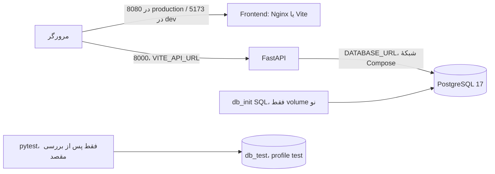

# زیرساخت، اجرا و استقرار

## توپولوژی تعریف‌شده

`docker-compose.dev.yml` سرویس‌های `db` با PostgreSQL 17 روی host:5433، `db_test` با profile `test` روی host:5434، `pgadmin` روی 5050، `backend` روی 8000 و `frontend` Vite روی 5173 را در شبکهٔ `tabulae-network-dev` تعریف می‌کند. bind mountهای backend/frontend توسعه را تازه‌سازی می‌کنند (`docker-compose.dev.yml`). `docker-compose.yml` سه سرویس db، backend و frontend Nginx روی 8080 را در `tabulae-network` تعریف می‌کند. DB در Compose تولیدی فقط به `127.0.0.1:5432` host منتشر می‌شود؛ توضیح کناری فایل دربارهٔ 5433 با مقدار واقعی ناسازگار است (`docker-compose.yml:25`). `depends_on` ترتیب شروع را بیان می‌کند، اما health check یا شرط آماده بودن DB تعریف نشده است.

هر دو Compose پوشهٔ کامل `db_init` را mount می‌کنند (`docker-compose.yml:23`، `docker-compose.dev.yml`، سرویس `db`). این پوشه علاوه بر ساخت schema، `02_insert_initial_data.sql` و `03_seed_stock_data.sql` را دارد؛ بنابراین volume تازه در Compose موسوم به production نیز دادهٔ seed می‌گیرد. مناسب بودن این داده برای production **نامعلوم** است و باید پیش از استقرار بررسی شود.



**تأییدشده:** `VITE_API_URL` در build frontend production از `docker-compose.yml` به `http://localhost:8000` تنظیم می‌شود، یعنی مرورگر کاربر به ماشین خودش مراجعه می‌کند (`frontend/Dockerfile:6-8,31-36`، `docker-compose.yml:45-48`). برای دامنهٔ production واقعی باید build arg و دسترسی API متناسب شوند. Nginx فقط فایل‌های SPA و fallback به `index.html` را دارد و reverse proxy `/api` تعریف نشده است (`frontend/nginx.conf:1-22`). backend مستقیماً روی port 8000 منتشر می‌شود (`docker-compose.yml:36`). TLS/gateway در مخزن دیده نشد. `backend/Dockerfile` کاربر non-root و چهار worker Gunicorn دارد؛ `Dockerfile.dev` Uvicorn reload اجرا می‌کند.

نام تنظیم‌ها در `.env.template`: `ENVIRONMENT`، `ALLOWED_ORIGINS`، `API_VERSION`، `SECRET_KEY`، `DATABASE_URL`، `ACCESS_TOKEN_DURATION`، `REFRESH_TOKEN_DURATION`، `TABULAE_DB_USER/PASSWORD/NAME` و `PGADMIN_DEFAULT_EMAIL/PASSWORD`. مقدارها در اینجا بازنشر نمی‌شوند. `get_required_env` فقط در غیر production، `.env` را با dotenv بار می‌کند (`backend/app/utils/getenv.py:4-13`). Compose با `env_file` مقدارها را به backend می‌دهد. `db_init/01_db_tables_trigger.sql` و seedها فقط هنگام مقداردهی volume اولیه اجرا می‌شوند؛ اجرای مجدد stack migration نیست (`docker-compose.yml:23`).

## فرمان‌های راهنما، اجرا نشده‌اند

فرمان‌های زیر در ریشهٔ مخزن و پس از بررسی `.env` و مقصد DB قابل استفاده‌اند. `down` بدون `--volumes` volume را نگه می‌دارد؛ اجرای هیچ فرمانی در تهیهٔ این سند انجام نشده است.

```powershell
docker compose -f docker-compose.dev.yml up --build
docker compose -f docker-compose.dev.yml up db backend
docker compose -f docker-compose.dev.yml up frontend
docker compose up --build
cd frontend
npm.cmd run build
npm.cmd test
npm.cmd run lint
cd ..
docker compose -f docker-compose.dev.yml logs -f backend
docker compose -f docker-compose.dev.yml ps
docker compose -f docker-compose.dev.yml down
```

backend test: ابتدا **به‌صورت دستی** اطمینان حاصل کنید hostname `db_test` به container مجزای تست اشاره می‌کند و دادهٔ ارزشمند ندارد؛ `backend/app/tests/conftest.py:54-94` پیش از هر تست جدول‌ها را پاک می‌کند. سپس `docker compose -f docker-compose.dev.yml --profile test up -d db_test` و آزمون را **در محیطی با DNS `db_test`**، مثلاً container backend همان شبکه با URL تست از پیش بررسی‌شده اجرا کنید. fixture مقدار URL را hardcode کرده و اجرای مستقیم از host به `127.0.0.1:5434` تغییر مسیر نمی‌دهد. نمونهٔ اجرای backend test پس از این تأیید: `docker compose -f docker-compose.dev.yml run --rm backend pytest app/tests -q`؛ قبل از استفاده باید مطمئن شد backend container متغیرهای لازم را دارد و `db_test` سالم است. این دستور در این بررسی اجرا نشد. برای health، `docker compose ... ps` فقط وضعیت container را نشان می‌دهد؛ endpoint health اختصاصی وجود ندارد، تنها GET `/` پیام پایه می‌دهد (`backend/app/main.py:59-61`).

CI/CD، migration versioned، health check، orchestration آماده بودن DB، backup/restore مستند و پیکربندی TLS در فایل‌های مخزن دیده نشد؛ وجود خدمات بیرونی **نامعلوم** است. log اختصاصی فقط هشدار شکست broadcast در `backend/app/routers/stock_moves.py:253-258` دیده می‌شود. وضعیت production واقعی بررسی نشده است.
