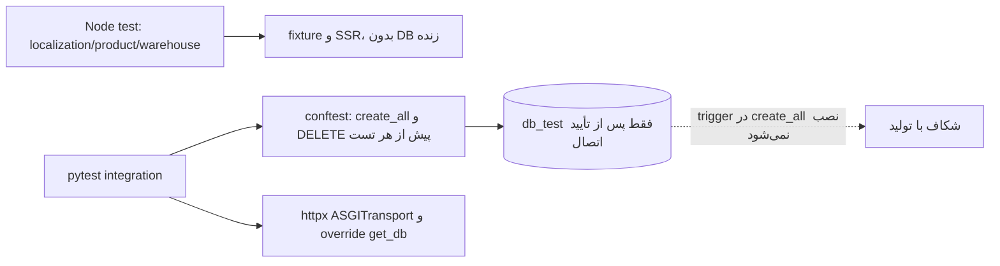

# آزمون و کیفیت؛ راهنمای امن

`frontend/package.json:6-14` چهار گروه Node test برای localization، application localization، product و warehouse تعریف می‌کند. آزمون‌های صفحه/فرم در `frontend/tests/*.test.mjs` با fixtureهای `frontend/tests/helpers/hookFixture.mjs` کار می‌کنند؛ برخی SSR component را بررسی می‌کنند. **اجرای فعلی تأییدشده:** `npm.cmd test` در ۱۵ اکتبر ۲۰۲۶، ۷۷ آزمون را با ۷۷ موفق و صفر شکست تمام کرد. `npm.cmd run lint` با exit 1 پایان یافت: ۱ خطای unused `user` در `frontend/src/pages/CreateMovement.jsx:19` و ۷ هشدار hook/Fast Refresh در `AuthProvider.jsx`، `Categories.jsx`، `Dashboard.jsx` و `Users.jsx`. `npm` در PowerShell این میزبان به خاطر execution policy اجرا نشد؛ `npm.cmd` کار کرد. build اجرا نشد.

`backend/app/tests/` فایل‌های `test_auth.py`، `test_users.py`، `test_products.py`، `test_product_categories.py`، `test_warehouses.py`، `test_stock.py`، `test_stock_movements.py`، `test_websocket.py` و `test_smoke_async.py` دارد. fixture اصلی `conftest.py:54-115` `TEST_DATABASE_URL` ثابت با host `db_test` دارد، با `SQLModel.metadata.create_all` جدول می‌سازد، **قبل از هر تست هشت جدول را DELETE می‌کند** و `get_db` را برای ASGI `AsyncClient` override می‌کند. `test_smoke_async.py:32-83` fixture جداگانه‌ای برای smoke دارد. **اجرای backend test انجام نشد** چون پاک‌سازی جدول‌ها با URL ثابت و نبود تأیید اتصال به پایگاه مجزای تست ریسک دارد. صرف وجود `db_test` در Compose دلیل کافی برای امن بودن اتصال جاری نیست. `conftest.py` trigger اولیهٔ SQL را نصب نمی‌کند؛ بنابراین آزمون‌های حرکت با DB ساخته‌شده از ORM ممکن است اثر واقعی trigger را نسنجند.

در `backend/app/tests/test_products.py` نام `test_admin_cannot_deactivate_product_with_stock` دو بار در خطوط 471 و 544 تعریف شده است؛ در Python تعریف دوم اولی را می‌پوشاند. این نتیجهٔ جست‌وجوی فعلی است و هیچ test run backend آن را اعتبارسنجی نکرده است. پوشش عددی/گزارش coverage در تنظیم‌های مخزن دیده نشد. `.github/workflows` در inventory وجود نداشت، پس CI در این checkout **مشاهده نشد**. lint frontend تنظیم `frontend/eslint.config.js` دارد؛ backend lint config مشخص دیده نشد.

## پیش از تغییر هر بخش

| بخش | بررسی کم‌خطر | آزمون وابسته به DB پس از تأیید مقصد |
|---|---|---|
| متن، RTL، صفحات React | `npm.cmd test`، `npm.cmd run lint`، در صورت نیاز `npm.cmd run build` | ندارد |
| auth/user | خواندن `dependencies.py` و `auth.py`؛ آزمون frontend | `test_auth.py` و `test_users.py` |
| محصول/دسته/انبار | آزمون frontend product/warehouse | `test_products.py`، `test_product_categories.py`، `test_warehouses.py` |
| stock/trigger | مرور SQL و schema، برنامهٔ rollback | `test_stock.py`، `test_stock_movements.py` و آزمون مستقل trigger روی DB جدا |
| WebSocket | مرور lifecycle و چند worker | `test_websocket.py` با DB جدا |

هیچ fixture پاک‌کننده‌ای را با development/production اجرا نکنید. در تست‌های واقعی trigger و FK/constraintهای SQL اولیه را نیز در محیط ایزوله نصب و با schema ORM مقایسه کنید؛ این پیشنهاد است، وضعیت موجود نیست.
